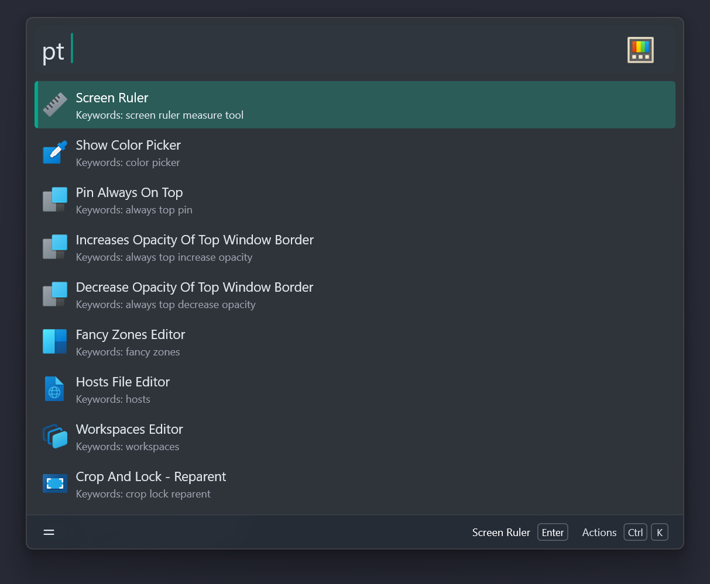

# Wox PowerToys plugin

Allows the user to launch some [PowerToys](https://github.com/microsoft/PowerToys) from [Wox](https://www.woxlauncher.com/) Launcher.

Heavily based on / inspired by the similar plugin for PowerToys Run.

## Screenshot



## Install

```shell
wpm install PowerToys
```

## Available Actions

- PowerToys Run
- Command Palette
- Measure Tool
- Shortcut Guide
- Color Picker
- Always on Top - Pin / Increase Opacity / Decrease Opacity
- Extract Text
- Fancy Zones Editor
- Hosts Editor
- Registry Preview
- Peek
- Workspaces
- Crop and Lock - Reparent / Thumbnail / Screenshot
- Environment Variables
- Exit Awake
- Show Advanced Paste UI
- Find My Mouse
- Mouse Highlighter
- Mouse Crosshairs
- Cursor Wrap
- Mouse Jump
- Light Switch Toggle
- ZoomIt - Exit / Zoom / Draw / Break / Live Zoom / Snip / Snip OCR / Snip & Dictate / Record
- Keyboard Manager
- MouseWithoutBorders - Toggle Easy Mouse / Reconnect
- Power Display - Toggle Profile / Terminate / Refresh Monitors / Rescan Monitors
- Grab And Move
- PowerToys Settings

## Other Features

- Some utilities have a context menu item for launching the given app as an admin
- Most utilities have a context menu item for opening the settings window for that utility
- Only utilities that are enabled in the PowerToys settings are shown
- Chinese utility titles can be searched by full pinyin or pinyin initials, for example `pt yanse` or `pt ys`
- Shows a warning if PowerToys is not running on your system

## How it works

Each action signals a named event that PowerToys itself waits on, so it behaves
exactly like pressing the utility's shortcut. "Run as Administrator" needs no
elevation code: it signals the utility's dedicated `*Admin` event and PowerToys
elevates itself.

The event names are copied verbatim from
[`src/common/interop/shared_constants.h`](https://github.com/microsoft/PowerToys/blob/main/src/common/interop/shared_constants.h)
and only cover events that PowerToys listens for (inbound). Internal or outbound
events are intentionally not exposed, for example the LightSwitch -> PowerDisplay
theme notifications, which do not switch the system theme.

If a future PowerToys release renames or removes an event, that single action
stops working and the plugin logs a warning instead of failing silently.

## Credits

- [PederBirk/Flow.Launcher.Plugin.PowerToys](https://github.com/PederBirk/Flow.Launcher.Plugin.PowerToys)
